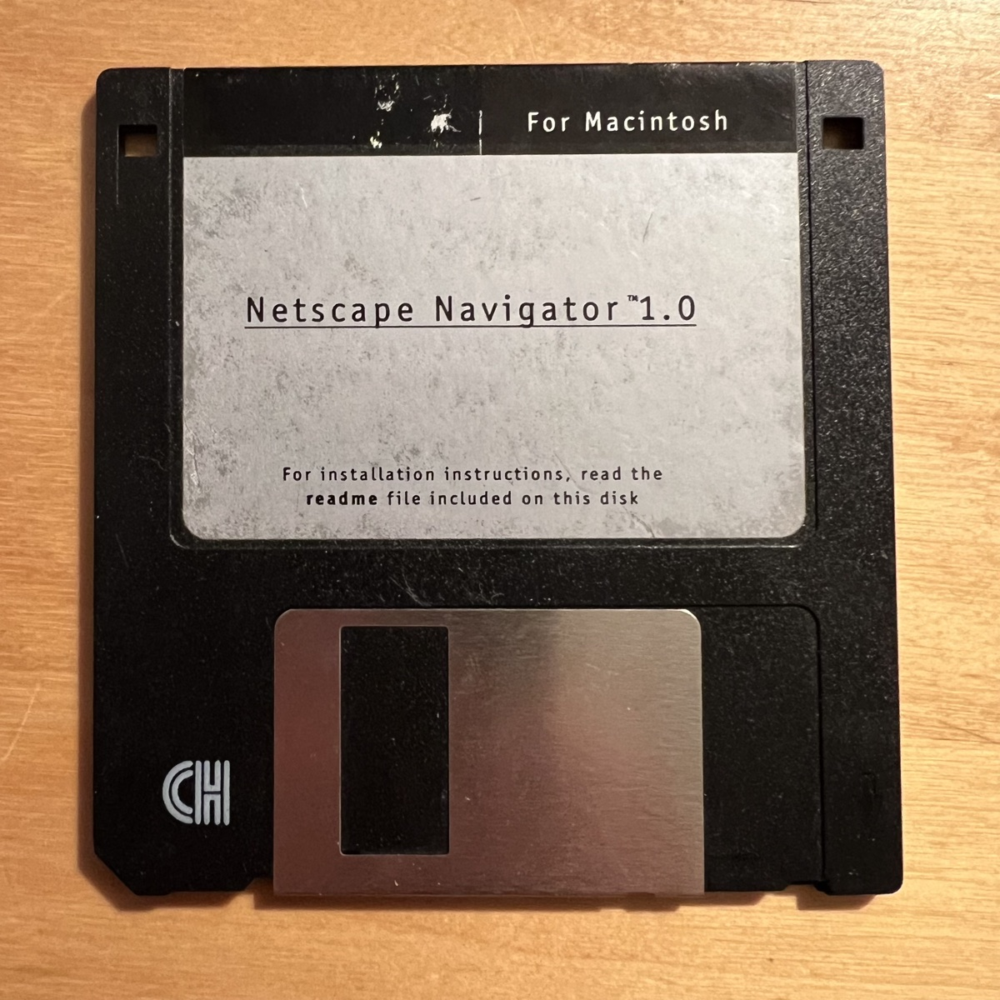

<p align="center">
  <picture>
    <source media="(prefers-color-scheme: dark)" srcset="docs/sextant-logo-dark.svg">
    
  </picture>
</p>

<h1 align="center">Sextant</h1>

<p align="center"><b>Take a fix on a faster, quieter, more private web.</b><br>
One command turns a stock Firefox or Chrome into a tuned, ad-free, tracker-resistant browser on macOS, Windows or Ubuntu, and keeps it that way.</p>

---

Out of the box, a browser downloads, runs and reports far more than the page you asked for: ad auctions, tracking scripts, fingerprinting probes, cookie walls, autoplay junk. Sextant takes a setup that was tuned by hand over years of daily use and installs it in one go, through the browsers' own administrator policies. Nothing is patched or hacked, and everything can be undone.

## What you get

**No ads, no trackers.** uBlock Origin in Firefox, loaded with 30 curated filter lists covering ads, trackers, malware, phishing, crypto miners and annoyances, and AdGuard in Chrome with its tracking, social, URL tracking, cookie notice and malicious URL filters. Firefox's own Enhanced Tracking Protection is switched on for cryptominers, fingerprinters and email tracking pixels, and Chrome blocks third-party cookies.

**Faster pages, lighter on RAM and CPU.** Ads and trackers are a large share of the scripts on a typical news or shopping page, and the fastest script is the one that never loads. Blocking them means less to download, parse and run, fewer background requests, and less work for the fans. Link prefetching is turned off so the browser stops loading pages you never clicked.

**Privacy you can measure.** In Firefox, canvas and WebGL fingerprints are randomized per site, Facebook is kept in its own container, and telemetry and studies are switched off. In both browsers, tracking parameters are stripped from links. Run [EFF's Cover Your Tracks](https://coveryourtracks.eff.org) before and after.

**Quieter browsing.** Cookie banners, newsletter pop-ups, chat widgets and notification prompts are dismissed or blocked before you see them.

**Pick your extras.** Optional extensions, offered rather than forced:

| extra | what it does |
|---|---|
| Bypass Paywalls Clean | reads articles behind soft paywalls (see the note below) |
| SponsorBlock, Return YouTube Dislike, Enhancer for YouTube | skip sponsor segments, see dislikes, take control of YouTube |
| h264ify / enhanced-h264ify | forces hardware-decoded H.264 video, cooler and easier on the battery for older Macs |
| OneTab, Sidebery, Vertical Tabs | tame a hundred open tabs and the memory they eat |
| Unpaywall, Wayback Machine | free legal copies of research papers, and the archived version of dead pages |
| Video Speed Controller, Markdown Here | small, well-loved conveniences |

**It stays current.** Every quarter Sextant checks each extension against Mozilla's and Google's stores: still listed, still maintained, same developer, still recommended. Extensions do get sold and turned malicious; this catches it. A Claude web review then reads the security news and proposes changes, with sources. You get the report by email.

**Safe by design.**
- Installs only from the official stores, with Bypass Paywalls Clean the one marked exception.
- Firefox settings are defaults the user can still change.
- Chrome only gets settings worth locking.
- One command removes it all.
- Nothing personal from the maintainer's own browser ever ships.

## Quick start

On the machine you want to set up (Python 3 is all it needs):

```
git clone <this repo> sextant && cd sextant
python3 sextant.py detect                               # what OS and browsers are here
python3 sextant.py apply --optional "sponsorblock"      # dry run: shows exactly what will change
python3 sextant.py apply --optional "sponsorblock" --yes
```

On Windows use `py` instead of `python3`, in a terminal opened with Run as administrator. Then restart the browsers and check `about:policies` (Firefox) and `chrome://policy` (Chrome). In AdGuard, import `baseline/adguard-settings.json` (Settings, General, Import settings).

With [Claude Code](https://claude.com/claude-code), just open it in this folder and ask it to set up the browsers: the bundled skill detects the OS, asks which extras you want, dry runs, applies and verifies.

## Supported platforms

| | Firefox | Google Chrome | Chromium |
|---|---|---|---|
| **macOS** | `policies.json` in the app bundle | configuration profile (approve in System Settings) | n/a |
| **Windows** | `policies.json` in the install folder | registry policy (`.reg`, with an undo file) | n/a |
| **Ubuntu** | `/etc/firefox/policies/` (snap or deb) | `/etc/opt/chrome/policies/managed/` | snap policy folders |

No Python on the target? Run `python3 sextant.py policies` anywhere and copy the files from `baseline/policies/`.

## About Bypass Paywalls Clean

It is optional and off unless you ask for it (`--optional bypass`). It is not in Mozilla's or Google's store: it installs from the developer's own server and updates itself from there, so its code is not store reviewed. Whether using it is allowed depends on where you are and on each site's terms; that call is yours. Firefox installs it by policy on every platform. Chrome installs it by policy on Linux, but on a Mac or Windows PC only when the machine is centrally managed (MDM, domain or Entra joined, or Chrome Enterprise Core); otherwise install it by hand.

## Undo

- **macOS:** remove the Sextant profile in System Settings, General, Device Management; delete `policies.json` from `Firefox.app/Contents/Resources/distribution/`.
- **Windows:** run `reg import baseline\policies\chrome\sextant-chrome-windows-remove.reg`; delete `distribution\policies.json` in the Firefox folder.
- **Ubuntu:** delete the policy files `apply` printed.

---

## For the maintainer

Sextant is built from the maintainer's own browsers. These commands run on the maintainer's Mac.

| command | what it does |
|---|---|
| `sextant.py export` | snapshots your Firefox and Chrome, ingests the uBlock Origin and AdGuard backups, writes the client-safe `baseline/` |
| `sextant.py policies [--optional ...]` | writes the policy files for every OS into `baseline/policies/` |
| `sextant.py check [--no-email] [--no-claude]` | the quarterly review |
| `sextant.py detect`, `sextant.py apply` | set up the machine it runs on |

**Exporting.** First back up the blockers: uBlock Origin Dashboard, Settings, **Back up to file**; AdGuard Settings, General, **Export settings**. Then `./venv/bin/python sextant.py export`. Backups are picked up from `~/Downloads`, `/private/tmp` or `private/inbox/`.

**Tiers.** `tiers.json` lists the extensions clients can get: **core** (always installed, cannot be removed) and **optional** (on request, can be disabled). Everything else you run, and anything new, lands in `private/tiers-private.json`. Move an entry into `tiers.json` to offer it.

**What stays private.** `private/` and `.env` are gitignored. They hold full browser snapshots, raw blocker backups (with your My filters and trusted sites), personal extensions, reports and the client list. The public baseline strips translation languages, Firefox Relay, history clearing, the DNS over HTTPS choice and the password manager choice; uBlock Origin loses My filters and personal trusted sites; AdGuard loses user rules, allowlist and regional lists.

**Quarterly check.** Drift in your own browsers since the export; store health for every extension (listed, last update, developer change, Mozilla Recommended badge, Manifest V2, and BPC's own update server); a Claude web review of the client baseline. Full report to `OWNER_EMAILS`, client version to `private/clients.txt` in Bcc, plus a macOS notification. It never changes a browser.

Setup and schedule (Jan, Apr, Jul, Oct, 1st at 10:00; a sleeping Mac runs it on wake):

```
python3.14 -m venv venv
cp .env.example .env && chmod 600 .env    # Gmail address, app password, OWNER_EMAILS
mkdir -p ~/Library/Logs/sextant
sed -e "s|__REPO__|$PWD|g" -e "s|__HOME__|$HOME|g" launchd.plist.template > ~/Library/LaunchAgents/local.sextant.plist
launchctl bootstrap gui/$(id -u) ~/Library/LaunchAgents/local.sextant.plist
```

## Why "Sextant"



A sextant is how a navigator takes a fix: one careful sighting, and you know where you are. The name is a nod to Netscape Navigator.

The maintainer has been online since 1989, browsed the early web in Mosaic, and still has the Netscape Navigator 1.0 for Macintosh installer on floppy. The label reads: *"For installation instructions, read the readme file included on this disk."* Some things never change.

<br clear="right">

## Sources

Firefox policies: mozilla/policy-templates `docs/index.md`. Chrome policies: Chromium `components/policy/resources/templates/policy_definitions`. uBlock Origin managed settings: uBO wiki, "Deploying uBlock Origin: configuration". Ubuntu snap policy paths: Ubuntu Discourse and Launchpad reports. All checked 2026-11-10.

## License

MIT. See [LICENSE](LICENSE).
